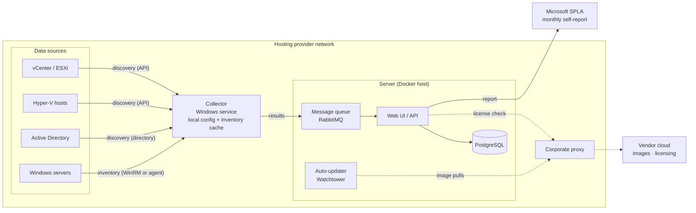
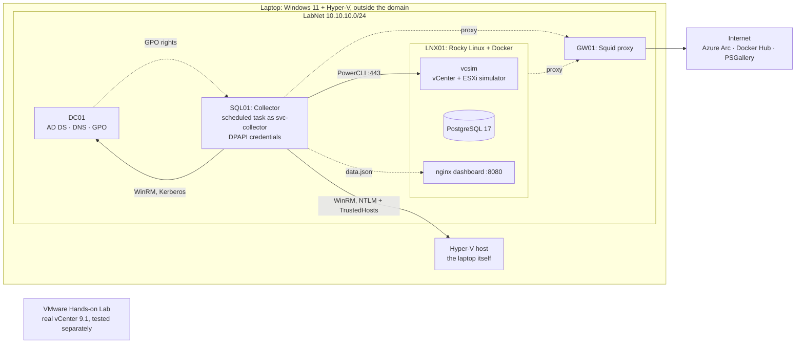

# Architecture

Two diagrams: **(1)** how a typical SPLA license-inventory product works, as I understood it from the vendor's public documentation (simplified, not an official diagram), and **(2)** the lab I built to reproduce it.

## 1. Reference architecture (based on public product documentation)

## 2. Lab (what I built)

## Mapping

| Reference | Lab |
|---|---|
| Collector | SQL01: PowerShell scripts run by a scheduled task |
| Server (Docker) | LNX01: Docker Compose with PostgreSQL + nginx |
| vCenter / ESXi | vcsim (simulator) + VMware Hands-on Lab (real) |
| Hyper-V hosts | The laptop, outside the domain |
| Active Directory | DC01 |
| Corporate proxy | GW01 (Squid), the only way out |
| Monthly report | Dashboard: licensed cores per host |

**Not reproduced:** message queue, agent-based mode, auto-updater (its main risk, a database major-version change, was tested by hand).
